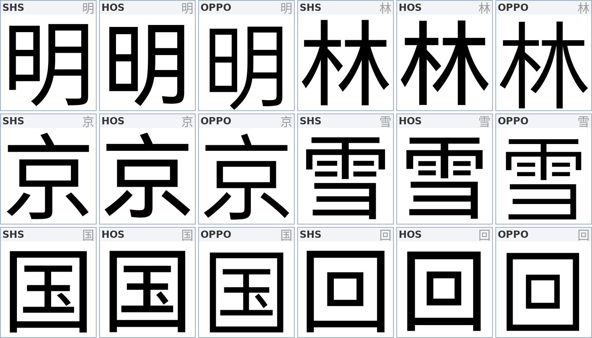
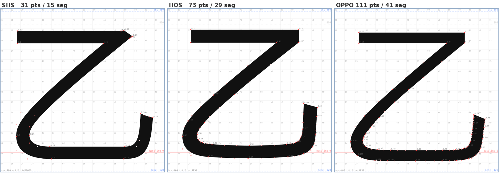
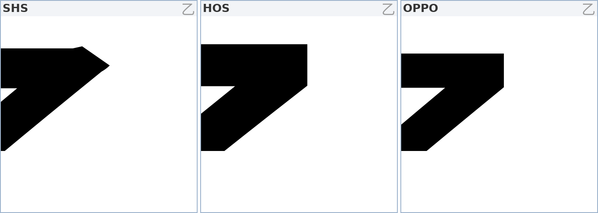
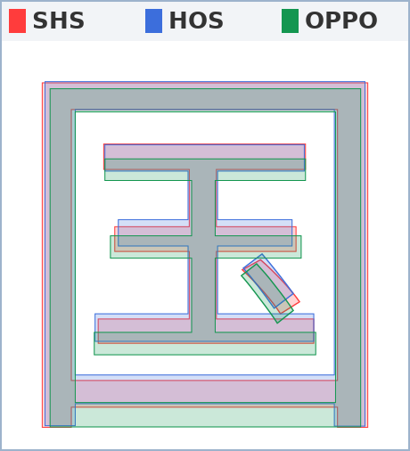

# 从零分析：能向鸿蒙与 OPPO 学什么

> 2026-10-23 · 不看旧结论，全部重量
> 工具：`metrics.py`（整体）、`profile.py`（布白剖面）、`detail.py`（单笔）、`montage.py`（对照图）

---

## 一、方法

按**结构类型**分组取样，每组 2–10 字，覆盖骨架差异最敏感的形状：

| 组 | 样本 |
|---|---|
| 独体 | 永木水火大小人心力女 |
| 上下 | 雪思花字京泉 |
| 左右 | 明林特到江部 |
| 包围 | 国回田同门图园 |
| 半包围 | 这建延局原 |
| 复杂 | 赢藏攀囊 |
| 极简 | 一二十丁厂 |
| 钩折 | 手寸事丁也己 |

三家都取 400 档（鸿蒙、OPPO、思源标称同一档，实际粗细差很多，见后）。

---

## 二、第一结论：骨架比例是一样的

先测最容易"以为有差异"的地方 —— 部件分界位置（上下结构的分界行、左右结构的分界列）：

| 字 | shs | hos | ops |
|---|---|---|---|
| 京 | 4/16 | 4/16 | 4/16 |
| 雪 | 8/16 | 8/16 | 8/16 |
| 思 | 9/16 | 9/16 | 9/16 |
| 花 | 5/16 | 5/16 | 5/16 |
| 明 | 7/16 | 7/16 | 7/16 |
| 江 | 5/16 | 5/16 | 5/16 |

**几乎完全一致。** 汉字的结构比例是几百年的共识，不是可以"创新"的地方。
所以差异只可能落在三个层面：**字面大小、笔画重量、笔画形状**。

后面的分析全部按这三层展开。

---

## 三、按结构类型的画像

字面率 / 留白 / 曲线占比 / 节点数（400 档）：

| 结构 | 指标 | shs | hos | ops | wdo |
|---|---|---|---|---|---|
| **独体** | 字面 | 0.837 | 0.825 | **0.842** | 0.803 |
| | 留白 | 0.763 | 0.740 | **0.784** | 0.754 |
| | 曲线 | 0.598 | 0.624 | **0.734** | 0.577 |
| | 节点 | **20.8** | 26.8 | 36.0 | 34.7 |
| **上下** | 字面 | 0.788 | 0.779 | **0.792** | 0.765 |
| | 曲线 | 0.239 | 0.308 | **0.436** | 0.258 |
| | 节点 | **44.8** | 51.0 | 61.8 | 48.8 |
| **包围** | 字面 | **0.724** | 0.686 | 0.668 | 0.683 |
| | 留白 | 0.574 | 0.539 | **0.601** | 0.556 |
| | 节点 | **28.7** | 29.0 | 31.2 | 29.5 |
| **极简** | 字面 | 0.500 | 0.505 | **0.510** | 0.487 |
| **钩折** | 字面 | **0.827** | 0.788 | 0.802 | 0.805 |



**读出来的三句话：**

1. **思源"外框撑满"**：包围 0.724、钩折 0.827 都是三家最大。
2. **OPPO"开放结构舒展、外框收敛"**：独体 0.842、上下 0.792、极简 0.510 最大，
   但包围只有 0.668（比思源小 8%）。
3. **鸿蒙"三项都略小、笔画最重"**：字面普遍最低（0.686–0.825），
   但笔画最粗（80/77），所以**黑度最高**。

---

## 四、方向（2026-10-23 修正）

初版把"传统黑体的手写感"当成优点在论证（出脚、撇捺收锋），方向错了。目标重定为：

> **简洁、干净、清爽；字多不累；弯钩与折笔的过渡圆润自然。**

这条目标直接推翻了两个结论：

| 原结论 | 修正后 |
|---|---|
| 学鸿蒙的出脚（93） | **出脚一律为 0** —— 出脚就是手写感 |
| 学思源的撇捺重收锋（1.5） | 收锋保留，但幅度降下来，避免"笔势"压过"干净" |

另外要分清两个容易混的东西：

- **方框直角**（口、国的四角）：四家都是 r=0，都是方肩。这条**没有差异**，也不是"圆润"的对象。
- **弯钩 / 折笔的转折**（乙、尤、九、心）：这里才是差异所在，也是唯一能做出"过渡自然"的地方。

---

## 五、弯钩才是差异所在

`乙尤九也心飞气乞` 八个弯钩类字的**源轮廓点数**（on-curve + off-curve 控制点，
即 `glyph_svg --points` 标出来的那些点）：

| 字 | shs | hos | ops |
|---|---|---|---|
| 乙 | **31** | 73 | 111 |
| 尤 | 57 | 110 | 122 |
| 九 | 45 | 78 | 120 |
| 也 | 65 | 101 | 167 |
| 心 | 52 | 103 | 137 |
| 飞 | 36 | 64 | 117 |
| 气 | 40 | 58 | 90 |
| 乞 | 47 | 89 | 122 |
| **合计** | **373** | **676** | **986** |

段数（绘制命令）：189 / 294 / 398。OPPO 点数是思源的 **2.6 倍**，段数 2.1 倍。



看 `乙` 的左下转折：

- **SHS**：4–5 段长直线 + 一个急转，节点稀。
- **HOS**：段数变多，转折处能看出明显的**折点**（方向突变）。
- **OPPO**：密集小段连成一条长弧，整段没有可见折点。

**OPPO 的"圆润"是用节点密度换来的，不是几何上一条光滑曲线。**
这是它最大的可取之处，也是最大的隐患：进正文就糊。

### 斜笔末端：出锋 vs 收方

`乙` 的右上角是最能说明问题的一处。放大看：



- **SHS**：斜笔末端冲出横画端点，做成一个**尖喙**，上面还带一个台阶，
  再往上收成一个锐角。远看像个小钩刺。
- **HOS**：这一处的角收成了竖直端面，干净了。但只改了一半 —— `九`、`飞` 还留着尖喙。
- **OPPO**：整个字族统一收方，`乙九凡飞` 全部是竖直端面。

用"最右点的转折角"量（180° = 端面平直，< 90° = 尖喙）：

| 字 | shs | hos | ops |
|---|---|---|---|
| 乙 | **78°** | 179° | 180° |
| 九 | 74° | **80°** | 175° |
| 凡 | 74° | 180° | 180° |
| 飞 | 62° | **76°** | 179° |

**这是"干净"最直接的判据**：斜笔末端不出露，收进横画端面，角做方。

### 对 WDesign Sans 的意义

数学上，90° 圆弧用 4–6 个控制点的三次贝塞尔就能做到误差 < 1 单位。
也就是说：**要 OPPO 的形状，不要 OPPO 的节点数。**

落地规则：

1. 转折处**切向连续（G1）**，相邻两段曲线在接缝处共享切线方向 —— 这是"没有折点"的定义。
2. 弯钩的**最小转折半径 ≥ 0.15 em（150 单位）**，且半径沿弧**平滑变化**（不做定值圆弧，做成缓入缓出）。
3. 每条弯钩轨迹用 **4–6 个节点**表达，不允许堆小段。
4. 折笔（横折）保留**方肩**：四家一致，也是黑体骨架；软化折角会让字发虚。

---

## 六、从鸿蒙能汲取的三条

### ① 笔画总量 +7%，但字面不放大

```
竖/横：hos 80/77   shs 75/71   ops 66/64
字面：hos 0.792    shs 0.803   ops 0.806
```

鸿蒙是唯一"笔画更粗、字面反而更小"的，单位黑度最高，小字号最清楚。

**落地**：竖笔 78±2（比思源高 4%），字面不低于 0.79。

### ② 左右结构墨量几乎相等

```
lr（左半/右半）：hos 0.998   ops 1.025   shs 0.937
```

思源右半比左半重 6.7%，整段会显得略"漂"；鸿蒙基本正。

**落地**：左右结构校验 `lr ∈ [0.96, 1.04]`。

### ③ 繁简补偿更稳

```
按节点数分四档，笔画宽度降幅：
shs 11.5%   hos 11.0%   ops 10.0%   wdo 11.0%
```

笔画多的字自动变细，整段灰度才均匀。OPPO 只降 10%，复杂字偏黑。

**落地**：笔宽随复杂度的降幅取 11%。

---

## 七、从 OPPO 能汲取的三条

### ① 包围结构适度收框

```
包围字面：shs 0.724   hos 0.686   ops 0.668
```

密排时框不蹭框 —— 这是"清爽"的第一来源，不是笔画细。



**落地**：包围类 0.68±0.02。但不收到 0.668，否则单字显小、与开放结构不齐。

### ② 中宫更空

```
独体留白：ops 0.784   shs 0.763
中央 4×4 墨量：ops 0.127   shs 0.141   wdo 0.147
```

内部透气。**落地**：core 目标 0.128–0.132。

### ③ 弯钩长弧（见第五节）

这是三家差距最大、也最值得学的一条。**学形状，不学节点数。**

---

## 八、明确不汲取的

| 来自 | 问题 | 数据 |
|---|---|---|
| 思源 / 鸿蒙 | **竖画出脚** | 口 +85 / +93 —— 这是手写感，目标为 0 |
| 思源 | 横竖反差偏大 | 1.068，字会显"硬"；目标 1.04 |
| 鸿蒙 | 行距过大 | typo 1056/−271，比思源大 20%，混排错行 |
| 鸿蒙 | 低字重不成比例 | 250 档 27 → 400 档 83，无法按比例外推 |
| OPPO | 400 档过细 | 竖 66，比思源细 12%，小字发灰 |
| OPPO | 节点过多 | 弯钩类合计 398（思源 189），正文会糊 |
| 旧版 | 只改字面不改笔画 | 笔画 76/72 ≈ 思源 75/71，字面却缩到 0.777，cap 被拉到 784 |

---

## 九、目标参数（修正版）

| 项 | 目标 | 来源 |
|---|---|---|
| 竖笔 | 78 ± 2 | 鸿蒙 80 / 思源 75 |
| 横笔 | 75 ± 2 | 使 H/V ≈ 1.04（更平、更干净） |
| H/V 反差 | 1.03–1.04 | 介于鸿蒙 1.034 与 OPPO 1.027 |
| 字面（整体） | 0.80 ± 0.01 | 思源 / OPPO |
| 字面（包围） | 0.68 ± 0.02 | OPPO |
| 中宫 core | 0.128–0.132 | OPPO |
| **出脚** | **0** | 抛弃手写感 |
| 折笔折角 | 方肩（r=0） | 四家一致 |
| **弯钩最小半径** | **≥ 150，且沿弧平滑变化** | OPPO 的形状 |
| **弯钩节点数** | **4–6 / 条** | 思源的预算 |
| **斜笔末端转折角** | **≥ 150°（平端面）** | OPPO：乙九凡飞 175–180° |
| 曲线占比 | 0.50–0.55 | 介于思源 0.37 与 OPPO 0.55 |
| 节点/字（整体） | ≤ 45 | 硬上限 |
| 繁简补偿 | −11% | 鸿蒙 11.0 / 思源 11.5 |
| 左右平衡 lr | 0.96–1.04 | 鸿蒙 0.998 |
| cap | 733 | 思源 |
| 垂直度量 | 880 / −120 | 思源 |

一句话：

> **方肩保留，出脚归零，弯钩做长弧；弧要 OPPO 的形状，用思源的节点预算。**

---

## 十、待验证

- "弯钩 4–6 节点做到 G1 连续"是否够 —— 需要拿 `乙` 实做一个对照。
- 折角方肩 + 弯钩长弧混在一起，会不会显得"两种性格" —— 只能出样张看。
- 钩折组样本仅有 `手寸` 进入 431 字统计，需补样本。
