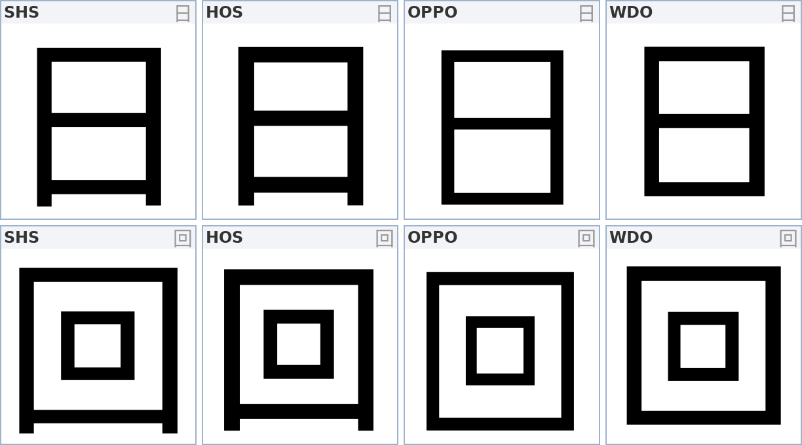
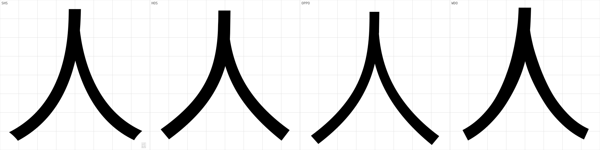

# 细节测量：笔法、出脚、收锋

> 2026-10-23 · 补充 [MEASUREMENTS.md](MEASUREMENTS.md) 的整体指标，这篇只看**单笔层面**
> 工具：`tools/detail.py`

整体指标（墨量、字面率、节点数）回答"哪家更黑更挤"，但回答不了
"这个拐角是方的还是圆的""竖笔有没有出头"。这篇补的就是后者。

---

## 方法与精度

所有量都取自轮廓本身：一维扫描线找墨缘、最小二乘拟合边界、圆弧几何反推半径。

**精度下限 ≈ 2 em 单位**。原因是很多字形的轮廓极简 —— 思源的 `口` 只有
5 个节点，`一` 只有 4 个。小于 2 单位的倒圆在轮廓上根本不存在，
所以下文的"0"应读作"在轮廓精度内没有"，而不是"绝对为零"。

---

## 一、笔法层：四家几乎完全一致

| 探针 | shs | hos | ops | wdo | 含义 |
|---|---|---|---|---|---|
| `一` 端面斜切 | 0.00° | 0.00° | 0.00° | 0.00° | 横画两端是正平切 |
| `二` 端面斜切 | 0.00° | 0.00° | 0.00° | 0.00° | 同上 |
| `口` 四边斜切 | 0.00° | 0.00° | 0.00° | 0.00° | 包围结构全是正交 |
| `口` 外角半径 | 0.0 | 0.0 | 0.0 | 0.0 | 尖角，无倒圆 |
| `十` 交接内角 | 0.00 | 0.00 | 0.00 | 0.00 | 纯直角搭接，无焊角 |
| `一` 厚度剖面 | 82/82/82 | 86/86/86 | 68/68/68 | 84/84/84 | 头/中/尾等粗，无顿笔 |

**结论：四家都是标准的"几何黑体"**，没有宋体式的顿笔、斜切、圆角、焊角。
所以"这笔收得圆不圆"不是它们的区别所在 —— 区别在**结构**。

> 这条结论有实际意义：做 WDesign Sans 时，笔法层可以**照抄思源的规范**
> （正交平切 + 尖角 + 等粗横画），不会与任何一家冲突。

---

## 二、竖画出脚：唯一的大差异

包围结构里，竖笔是否比底横多探出一截。

| 字 | shs | hos | ops | wdo |
|---|---|---|---|---|
| `口` | **+85 / +81** | **+93 / +88** | 0 / 0 | 0 / 0 |
| `日` | +65 / +60 | +68 / +67 | 0 / 0 | 0 / 0 |
| `田` | +62 / +62 | +72 / +72 | 0 / 0 | 0 / 0 |
| `目` | +68 / +68 | +71 / +68 | 0 / 0 | 0 / 0 |
| `回` | +54 / +54 | +63 / +63 | 0 / 0 | 0 / 0 |
| `国` | +51 / +51 | +56 / +57 | 0 / 0 | 0 / 0 |

单位 em/1000，左/右分开测。正值 = 竖笔比底横更低。

**发现**

1. **思源与鸿蒙都出脚，OPPO 与旧版完全齐平。**
   这不是笔误级的差别：`口` 出脚 85 单位，比它自己的笔画宽度（75）**还长**。
2. 出脚量随字形复杂度递减：`口` 85 → `日` 65 → `回` 54 → `国` 51。
   即**越复杂的包围结构，出脚越收敛** —— 这是刻意的视觉补偿，
   简单字需要更多"手写感"来避免呆板。
3. OPPO 和旧版是 0，说明 OPPO 走的是**纯几何**路线（横平竖直、四边齐平），
   和思源/鸿蒙的**传统黑体**路线是两个流派。

> **这一条先要定下来。** 出脚是"传统黑体"的识别特征，一旦选定某个流派，
> 后面所有包围结构（口日田目回国囚四）都要跟着走，改起来是全局返工。

---

## 三、撇捺收锋

沿 y 扫描，取最左/最右笔道的中线与宽度，算起笔宽 ÷ 收笔宽。

| | shs | hos | ops | wdo |
|---|---|---|---|---|
| `人` 撇 起→收 | 103 → 81 | 99 → 86 | 87 → 69 | 95 → **97** |
| `人` 撇 收分比 | 1.3 | 1.2 | 1.3 | **1.0** |
| `人` 捺 起→收 | 106 → 72 | 101 → 77 | 89 → 64 | 90 → **85** |
| `人` 捺 收分比 | **1.5** | 1.3 | 1.4 | **1.1** |
| `大` 撇 收分比 | 1.4 | 1.3 | 1.2 | 1.3 |
| `大` 捺 收分比 | 1.4 | 1.4 | 1.4 | 1.3 |
| `木` 撇 收分比 | 1.4 | 1.4 | 1.4 | 1.3 |
| `木` 捺 收分比 | **1.5** | 1.2 | **1.6** | 1.4 |

**发现**

1. **思源的撇捺收锋最狠**（`人` 捺 1.5、`木` 捺 1.5），末端收到 72 单位。
2. **旧版的 `人` 撇几乎不收锋**：起笔 95、收笔 97，比值 1.0 —— 末端比起笔还略宽。
   捺也钝（1.1，末端 85 单位）。这是二次量化把曲线压平后，
   收笔的锥形被"抹平"的典型结果。
3. OPPO 的收分比不低（1.3–1.6），但**起点就细**（87 vs 思源 103）。
   所以它是"细而锐"，思源是"粗而锐"。

---

## 四、横竖对比

| | 竖笔 | 横笔 | H/V | 说明 |
|---|---|---|---|---|
| **shs** | 75 | 71 | **1.068** | 横竖反差最大 |
| wdo | 76 | 72 | 1.039 | |
| **hos** | 80 | 77 | 1.034 | 两笔一起加粗 |
| **ops** | 66 | 64 | **1.027** | 几乎等粗 |

横画比竖画细是黑体的基本规律，思源把这条做到了 **6.8% 的反差**，
OPPO 只有 2.7% —— 这就是为什么 OPPO 看起来"更平、更几何"，
而思源有"呼吸感"。

---

## 五、对 WDesign Sans 的意义

1. **笔法层直接照抄思源**：正交端面、尖角、等粗横画、H/V ≈ 1.07。
   四家在这层没有分歧，没有创新空间，也没有风险。
2. **出脚必须早定**。这是流派选择，不是参数微调：
   - 走传统黑体 → 出脚 50–90，且按复杂度递减
   - 走几何黑体 → 全齐平，但会丢掉一部分"人味"
   建议走**传统黑体 + 出脚**，因为基座是思源，改成几何路线等于重画。
3. **撇捺收锋不要低于 1.3**。旧版 1.0 的教训摆着：收锋没了，
   字会显得钝、闷、没有笔势。
4. 建议把三条加进闸门：

   | 指标 | 目标 |
   |---|---|
   | 端面斜切 | ≤ 0.5°（正交） |
   | `口` 出脚 | 80 ± 10（左）/ 一致（右） |
   | 撇捺收分比 | ≥ 1.3 |

---

## 局限

- 端面/转角只能测到轮廓精度（≈2 单位），更小的倒圆在这个分辨率下不存在。
- 出脚只适用于**四方包围**结构；`月` 这类带钩的字不适用（钩会干扰测量）。
- 撇捺用最左/最右笔道近似，遇到三笔并列（`川`）会失效，故只选了 `人`/`大`/`木`。
- 直方图式的"交接发黑"指标做不出稳定结果（窗口法会饱和），
  改用交接内角距离替代，四家都是 0 —— 即都没有焊角。
