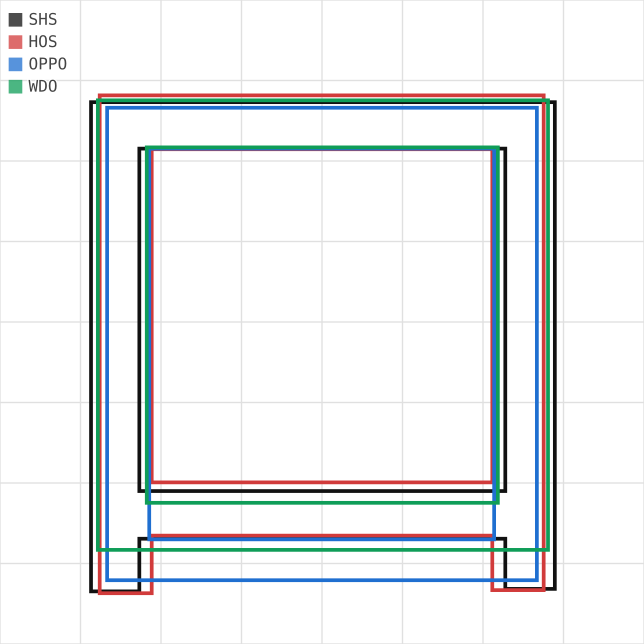
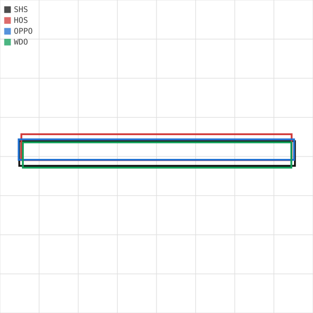
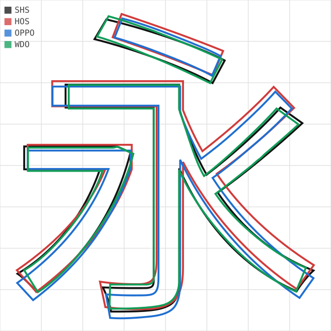
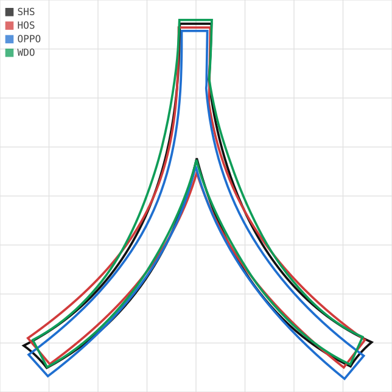
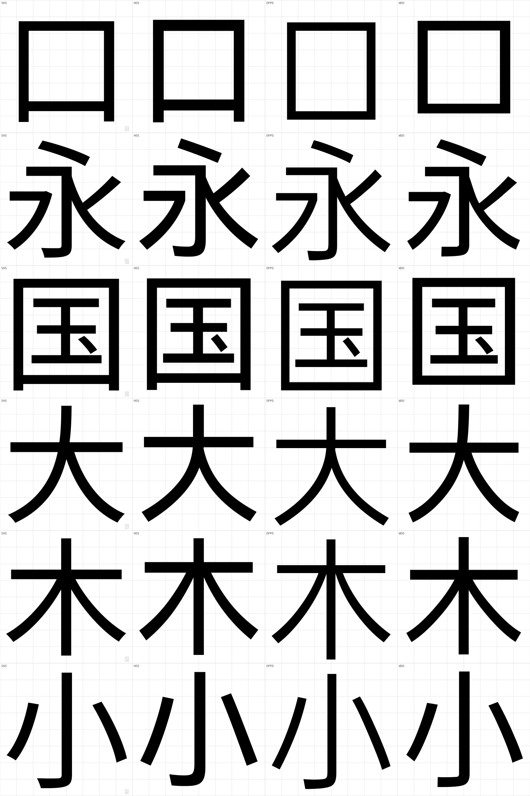

# 四家字体特征测量

> 2026-10-23 · 样本 431 字 · w=400 · 全部为**几何计算**，不经光栅化

## 方法

`tools/metrics.py` 直接读轮廓：曲线展平后按格林公式算面积与重心，
笔画粗细用一维扫描线取交点（非估算、非像素统计）。

| 指标 | 定义 | 单位 |
|---|---|---|
| `ink` | 墨面积 ÷ em 框面积 | 比例 |
| `竖 / 横` | 横向扫描线的墨段宽度 / 纵向扫描线的墨段高度，取中位 | em 单位 |
| `face` | 字形包围盒面积 ÷ em 框面积（字面率） | 比例 |
| `white` | 1 − 墨面积÷包围盒面积（字形内部留白） | 比例 |
| `curve` | 三次曲线指令 ÷ (曲线+直线) 指令数 | 比例 |
| `节点` | 轮廓节点数（不含展平子段） | 个 |
| `重心偏` | 墨重心到 (500, 340) 的距离 | em 单位 |

样本取自 [COMMON](../tools/metrics.py) 列表：覆盖独体/上下/左右/包围/半包围/复杂/极简，
四家缺口均为 0。

---

## 一、垂直度量

| | upm | hhea asc | hhea desc | typo asc | typo desc | win asc | win desc | cap | x-height | CJK | 总字形 |
|---|---|---|---|---|---|---|---|---|---|---|---|
| **shs** 思源黑 | 1000 | 1160 | −288 | 880 | −120 | 1160 | 288 | 733 | 543 | 20992 | 65535 |
| **hos** 鸿蒙 Sans | 1000 | 928 | −244 | 1056 | −271 | 1056 | 271 | 700 | 500 | 20902 | 29221 |
| **ops** OPPO Sans | 1000 | 1000 | −319 | 850 | −150 | 1000 | 319 | 732 | 396 | 20902 | 28488 |
| **wdo** 旧版 | 1000 | 1160 | −288 | 880 | −120 | 1160 | 288 | **784** | **563** | 20972 | 31916 |

**发现**

1. **`wdo` 的 cap 784 / x-height 563 与 POSTMORTEM 记录的旧版错误完全一致**
   （正确值 733 / 543）。多出来的 51 单位字高不是设计，是二次量化的结果。
2. `ops` 的 cap 732 与 `shs` 的 733 只差 1 单位 —— OPPO 的汉字字面高度是照着思源定的。
3. `hos` 的 typo 上下距是 1056/−271，比 `shs` 的 880/−120 宽松一大截。
   **同一 font-size 下鸿蒙的行距会明显更大**，混排时不能直接比。

---

## 二、粗细（同为 400 字重）

| | ink | 竖笔 | 横笔 |
|---|---|---|---|
| **hos** | 0.298 | **80** | **77** |
| **wdo** | 0.277 | 76 | 72 |
| **shs** | 0.279 | 75 | 71 |
| **ops** | 0.254 | **66** | **64** |

**发现**

1. **`shs` 与 `wdo` 的笔画宽度几乎完全相同**（75/71 vs 76/72）。
   旧版的问题从来不在笔画 —— 它原样继承了思源的笔画宽度。
2. `hos` 在标称 400 处比 `shs` 重 **7%**；`ops` 轻 **12%**。
   三家都写 400，实际深浅差了一档半。**"看重量选字体"必然会踩坑。**
3. `ops` 的 `一` 只有 68 厚、`hos` 有 86 —— 同一横画差 **26%**。

---

## 三、字面率与中宫

| | face | white | 左余 | 右余 | 上余 | 最低点 | `口` 宽×高 | `口` 宽高比 |
|---|---|---|---|---|---|---|---|---|
| **shs** | **0.803** | 0.651 | 48 | 58 | 174 | −72 | 749×790 | 0.95 |
| **hos** | 0.792 | 0.622 | 50 | 65 | 171 | −65 | 717×804 | **0.89** |
| **ops** | **0.806** | **0.682** | 49 | 67 | **184** | **−95** | 694×763 | 0.91 |
| **wdo** | **0.777** | 0.642 | **62** | **72** | 165 | −61 | 727×726 | **1.00** |

**发现**

1. **`wdo` 左右各多留 14 单位**（62/72 vs 48/58），字面率掉到 0.777。
   笔画没变、字面缩小 → **同样粗细塞进更小的框里，视觉上变挤、变黑**。
   这就是"旧版更重"这个错觉的真正来源：不是笔画重，是字面小。
2. `hos` 的 `口` 宽高比 0.89，明显竖长 —— 鸿蒙的包围结构偏瘦高。
3. `wdo` 的 `口` 宽高比 1.00，正方 —— 这是被"拉方"的痕迹，和 784 的 cap 是同一个动作。
4. `ops` 的 `口` 最小（694×763），但留白率最高（0.682）—— 因为它笔画最细。

---

## 四、构造复杂度

| | 节点/字 | `永` 节点 | `人` 节点 | 曲线占比 | 每万单位²墨的节点 |
|---|---|---|---|---|---|
| **shs** | **42** | **32** | **9** | 0.37 | 1.5 |
| **hos** | 47 | 34 | 16 | 0.41 | 1.6 |
| **wdo** | 52 | **54** | 25 | 0.39 | 1.9 |
| **ops** | **61** | 47 | 19 | **0.55** | 2.2 |

**发现**

1. **`ops` 用 61 个节点、55% 曲线来画同一个字**，`shs` 只用 42 个、37%。
   OPPO 的弧线更圆、更连续，代价是数据量多 45%。
2. **`wdo` 的 `永` 有 54 个节点但曲线只有 0.46** —— 节点多、曲线少，
   说明它用**大量短直线拼接曲线**。这是 CFF→TTF 二次量化的典型指纹：
   曲线被压成折线，再用控制点强行拟合回去。
3. `shs` 的 `人` 只有 9 个节点（一撇一捺各 4–5 段），是全组最省的。

---

## 五、字重阶梯（90 字子样本）

| 字重 | | 250 | 300 | 350 | 400 | 500 | 700 | 900 |
|---|---|---|---|---|---|---|---|---|
| **shs** 竖 | | 30 | 50 | 70 | 79 | 100 | 127 | 155 |
| | ink | 0.097 | 0.156 | 0.213 | 0.238 | 0.296 | 0.368 | 0.438 |
| **hos** 竖 | | 27 | 54 | — | 83 | 97 | 127 | 147 |
| | ink | 0.088 | 0.172 | — | 0.254 | 0.293 | 0.372 | 0.423 |
| **ops** 竖 | | — | 36 | — | 68 | 90 | 118 | 136 |
| | ink | — | 0.119 | — | 0.214 | 0.277 | 0.352 | 0.394 |
| **wdo** 竖 | | 30 | 50 | 70 | 79 | 100 | 128 | 156 |
| | ink | 0.096 | 0.154 | 0.211 | 0.235 | 0.292 | 0.364 | 0.433 |

**发现**

1. **`shs` 的 350 → 400 只增加 9 单位**（70 → 79），而 250→300、300→350 各 +20。
   Regular 这一档的涨幅只有常规档的 45%。做字重映射时这一档要单独处理。
2. `wdo` 的阶梯与 `shs` **逐档一致**（30/50/70/79/100/128/156 vs 30/50/70/79/100/127/155），
   再次证明旧版没动笔画。
3. `ops` 每档 +18~32，跨度偏小 —— 900 只有 136，而 `shs` 900 是 155。
   **OPPO 的 Heavy 不够重**，做七档会缺一个真正的黑。
4. `hos` 250 只有 27，比 `shs` 250 的 30 还细，但 400 反而更重 —— 曲线非线性。

---

## 六、细节叠图

同一画框、同一基线，四家叠在一格里（轮廓线模式）。

### `口`：字面与转角

- 绿（wdo）内外框都最小，四边同时内缩 —— 字面缩小的直接证据
- 蓝（ops）左右最宽，底部两角有明显外扩
- 黑（shs）/ 红（hos）外框接近，hos 略高

### `一`：横画厚度

- 红（hos）最厚且位置最高
- 蓝（ops）最薄，位置略低
- 黑（shs）与绿（wdo）几乎完全重合

### `永`：构造

- 蓝（ops）的钩、撇明显更圆，起笔处收得更细
- 绿（wdo）在转折处出现折线感（节点多、曲线少）

### `人`：撇捺弧度

- 黑（shs）9 个节点画完，是唯一的"一段到底"
- 绿（wdo）25 个节点，捺的末端抖动可见

### 整字对照表

---

## 七、对 WDesign Sans 的结论

1. **基座选 `shs` 是对的**：字面率最高（0.803）、节点最省（42）、
   曲线占比 0.37 —— 在正文尺寸下最不容易糊。
2. **不要照 `ops` 的构造密度做**。61 个节点 / 0.55 曲线在展示字号好看，
   13px 正文会开始发灰。可以借它的**弧线过渡**，但不能借它的**节点预算**。
3. **旧版的教训可以量化了**：它的错误不是"笔画太重"，而是
   **笔画没变（76/72 ≈ 75/71）而字面缩小了 3.2%**（0.777 vs 0.803），
   同时 cap 被拉到 784。修的时候必须**同时**调字面和笔画，只调一头会更糟。
4. **字重曲线要重做**。`shs` 350→400 只差 9，不能直接沿用；
   `ops` 的 900 不够黑，也不能直接抄。
5. **验收阈值**（建议写进 PIPELINE 闸门）：

   | 指标 | 目标 | 依据 |
   |---|---|---|
   | 字面率 | 0.80 ± 0.01 | 不低于 shs 的 0.803 |
   | 竖笔 | 75 ± 2 | shs 400 |
   | 横笔 | 71 ± 2 | shs 400 |
   | 曲线占比 | 0.35 – 0.40 | shs 0.37 |
   | 节点/字 | ≤ 45 | shs 42，ops 61 为上限外 |
   | cap | 733 | 不得回到 784 |

---

## 局限

- 笔画粗细由 3 条扫描线取中位，斜笔（撇捺）不在其中，只反映横竖主干。
- `ops` 的 300/900 是精简版（6763 个 CJK），阶梯表里这两档只能作参考。
- 字面率用包围盒，对"极简部首字"（一、二）会偏小，跨字比较时看中位数而非均值。
- 未测：转折半径、收笔形状、笔画交接处的黑度。这三项目前只能看图。
